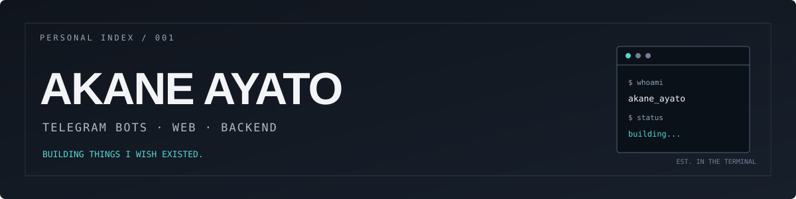

 

## About

Hey, I'm **Akane**. I build Telegram bots, web projects, and backend APIs. Outside of code, I'm usually watching anime or reading manga and manhwa.

I like making useful things, figuring out how they work, and improving them until they feel right.

## What I work on

- **Telegram:** bots, automation, file tools, and channel utilities.
- **Backend:** Python, FastAPI, REST APIs, scraping, and database-backed services.
- **Web:** frontend integrations and API-powered applications.
- **Anime & manhwa:** projects and tools for the things I enjoy.

## Tools I use

  

## GitHub

## Elsewhere

- Telegram: [@Ayato_Akane](https://t.me/Ayato_Akane)
- Anime channel: [@ITsAnimen](https://t.me/ITsAnimen)
- Spotify: [Listen here](https://open.spotify.com/user/31ifxbg366477gfip5f2hws2jule)

---

「 one more commit, then one more episode. 」

